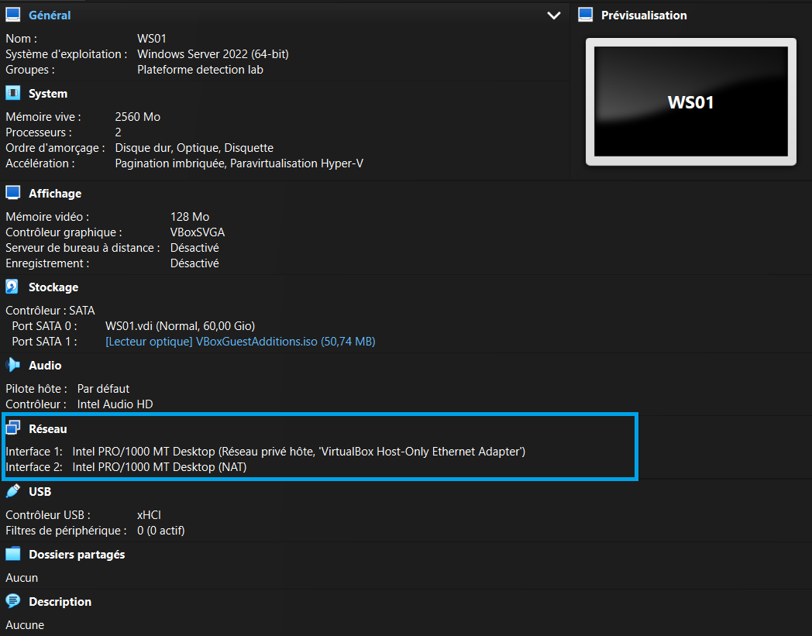
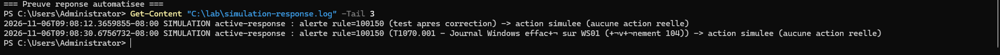

# Detection-as-Code Lab: Wazuh + Sysmon + ATT&CK

A home SOC lab that detects **8 MITRE ATT&CK techniques** with custom Wazuh rules,
validates them against independent attack replays, measures false positives over a
baseline window, and triggers an automated response. Built on an **8 GB laptop**,
fully isolated, at **zero cost**.

> Detection logic is versioned as code, with positive/negative test fixtures and a
> CI workflow — the same way production detection engineering is done.

---

## Summary

| What | Result | Evidence |
|------|--------|----------|
| Techniques detected | **8 / 8** | `docs/evidence/e-campagne-finale.txt` |
| False positives (2 h baseline) | **2 → 0** after tuning, detection preserved | `docs/evidence/e-baseline-apres.txt` |
| Automated response | active response (simulation), **~4 s** reaction | `docs/evidence/f-delai-reaction.txt` |
| Rules validated | unit (`wazuh-logtest`) + live | `docs/evidence/c*-*.txt` |

---

## Stack (versions used)

| Component | Version |
|-----------|---------|
| Wazuh manager (standalone, no indexer/dashboard) | 4.14.9 |
| Sysmon (sysmon-modular config, Olaf Hartong) | 15.22 |
| Windows endpoint | Windows Server 2025 (Eval) |
| Domain Controller | Windows Server 2025 (Eval), AD DS |
| Manager OS | Ubuntu Server 24.04 LTS |
| Hypervisor | VirtualBox 7.2 |

---

## Architecture

A **standalone Wazuh manager** (analysis + rules + active response). No indexer and
no dashboard: detection happens in `wazuh-analysisd`, and alerts are read directly
from `alerts.json`. This fits an 8 GB host and keeps the project fully "as code".

        host-only lab network 192.168.56.0/24
+---------------------+ +----------------------------+
| WS01 .20 | | DC01 .30 |
| Windows Server 2025| | Windows Server 2025 (AD) |
| Sysmon + agent | | KDC, svc-sql SPN + agent |
+----------+----------+ +-------------+--------------+
| Sysmon / Security / Defender / System | Security 4769
| (1514/1515, encrypted) |
+---------------------+----------------------+
|
+----------v-----------+
| WAZUH .10 |
| Ubuntu 24.04 |
| manager 4.14.9 |
| rules + active-resp |
| -> alerts.json |
+----------------------+

Each VM has **two NICs**: a host-only NIC (isolated lab, static IP) and a NAT NIC
(install only, **unplugged during attacks** — isolation verified, see
`docs/evidence/a-isolement.txt`).

---

## Detected techniques & rules

| # | ATT&CK | Rule | Event source |
|---|--------|------|--------------|
| 1 | T1059.001 — Encoded PowerShell     | 100110 | Sysmon EID 1 |
| 2 | T1547.001 — Run key persistence    | 100120 | Sysmon EID 13 |
| 3 | T1053.005 — Scheduled task         | 100130 | Security 4698 |
| 4 | T1136.001 — Local account creation | 100140 | Security 4720 |
| 5 | T1070.001 — Event log clearing     | 100150 | Eventlog 1102/104 |
| 6 | T1562.001 — Defender disabling     | 100160 | Defender 5001 |
| 7 | T1003.001 — LSASS dumping          | 100170 | Sysmon EID 11 |
| 8 | T1558.003 — Kerberoasting          | 100180 | Security 4769 |

**Exclusions** (false-positive tuning, level 0): `100121` (legit VBoxTray Run key),
`100131` (Defender system scheduled task). Both are surgical — a malicious lookalike
still fires (verified).

Full ruleset: [`rules/local_rules.xml`](rules/local_rules.xml).

---

## Design choices (and why they matter in detection)

- **`originalFileName` over `image`** (rule 100110): survives tool renaming.
- **System-level events over tool names** (100130/100140 on Security 4698/4720):
  a scheduled task is caught whether created via `schtasks`, PowerShell or the API.
- **Dump-file creation over memory access** (100170 on Sysmon EID 11): the
  sysmon-modular config excludes `taskmgr.exe` from EID 10, so LSASS access via Task
  Manager is blind on EID 10 — EID 11 (the `.dmp` write) catches it instead.
- **High-fidelity Kerberoasting** (100180): RC4 ticket (`0x17`) + service and
  requester that are **not** machine accounts — the documented low-false-positive pattern.

---

## Automated validation (GitHub Actions)

Two levels of testing, each where it belongs:

- **Structure (CI, blocking):** on every push, the workflow validates the rules —
  valid XML, custom IDs (>= 100000), MITRE mapping on every detection rule. This
  proves the rules are **well-formed**, not that they **detect**.
- **Detection (local, authoritative):** each rule is tested with positive and
  negative fixtures via `wazuh-logtest`, then confirmed live. Evidence in
  `docs/evidence/`. A best-effort CI job attempts the same in a Wazuh container, but
  the CI container is restricted (permissions, and the Windows `eventchannel`
  decoder), so **detection is validated on the lab, not in CI**.

Workflow: [`.github/workflows/test-rules.yml`](.github/workflows/test-rules.yml).

---

## Repository layout
rules/ custom Wazuh rules (local_rules.xml) + exclusions
config/ Sysmon config, agent localfile, active-response snippet
tests/ structure validator, logtest runner
tests/fixtures/ positive/negative event fixtures per technique
docs/evidence/ raw command outputs (proof)
docs/screenshots/ illustrations

---

## Limitations (honest)

- **No indexer/dashboard** — chosen to fit 8 GB RAM. Detection is unaffected (it
  happens in the manager); search, history and visualization are not available.
- **T1003.001** — the procdump replay was **blocked by Microsoft Defender** (proof:
  `docs/evidence/d-t1003-defender-block.txt`). The rule detects dump-**file** creation,
  so a fully in-memory LSASS theft (e.g. Mimikatz) would not be seen. Defense in depth:
  Defender blocks, Wazuh would detect if bypassed.
- **T1070.001 / T1562.001** — no Atomic test for these sub-techniques in the pulled
  library; replayed manually (the observable behavior is identical).
- **T1558.003** — played from the DC itself (RAM limit), so network propagation from a
  client is not tested. The 4769 event is identical.
- **Active response** runs in **simulation mode** (logs the action instead of executing
  it). Switching to a real action only requires replacing the logging line.
- **"0 false positives"** refers to the **8 custom rules**, not the full Wazuh ruleset.

---

## Validation method

Each rule is tested with positive **and** negative fixtures via `wazuh-logtest`, then
confirmed live. Attacks are replayed independently with **Atomic Red Team** where a
test exists, to prove the rules detect the **technique**, not just my own replay.